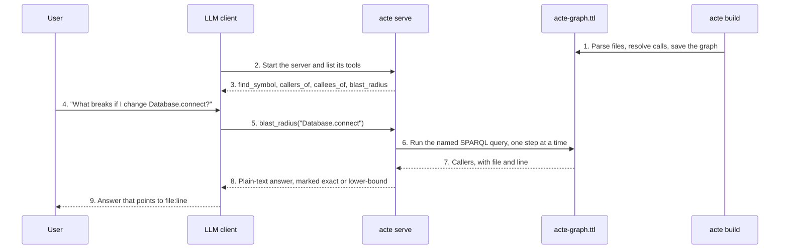

# ACTE: Autonomous Codebase Topography Engine

ACTE reads a project's source code and builds a graph of it: files, classes, functions, and
which function calls which. The graph is stored as RDF and queried with SPARQL. An LLM can
then ask questions like "who calls this function?" and get an answer from the graph, with
file and line for each result.



## How it works

| Layer | What it does |
|---|---|
| 1. Parse | tree-sitter reads each file and finds its classes, functions, imports and calls |
| 2. Resolve | for each Python call, works out which function it runs; calls it cannot decide are kept and marked |
| 3. Build | the results are stored as RDF triples and can be saved as Turtle (`.ttl`) |
| 4. Query | a fixed set of SPARQL queries answers callers, callees, dependencies and dead code |
| 5. Serve | an MCP server lets an LLM run those queries as tools |

The LLM picks a query and gives it a name to look up. It does not write SPARQL itself.
`acte impact` and `acte analyze` work on the same graph from the command line.

## Status

You can build a map of a Python project and let an LLM client query it over MCP. The project
is still young.

| Part | State |
|---|---|
| Parsing | Python. Java, JavaScript, TypeScript, TSX and Go give structure only |
| RDF graph and Turtle output | Working |
| Call resolution | Python only (see Limitations) |
| Command line (`acte build`, `acte stats`, `acte impact`, `acte analyze`, `acte serve`) | Working |
| Checks on real projects | Working (rich, httpx, click, flask, requests) |
| MCP server | Working, tested with opencode and Claude Code |

## Quickstart

```bash
pip install "acte[jedi] @ git+https://github.com/dhruv970331/Autonomous-Codebase-Topography-Engine.git"
cd your-project
acte build .            # writes acte-graph.ttl
```

To connect a client, copy [`examples/opencode.json`](examples/opencode.json) or
[`examples/mcp.json`](examples/mcp.json) (renamed to `.mcp.json` for Claude Code) into the
project folder. More in [`examples/README.md`](examples/README.md).

## Requirements

Python 3.11 or newer, and [Poetry](https://python-poetry.org/).

```bash
poetry install
poetry run pytest -q
```

To also test against pinned releases of rich, httpx, click, flask and requests, run
`ACTE_REAL_REPOS=1 poetry run pytest tests/test_real_repos.py -s`. This is off by default.
It needs git and network access the first time, and takes about 5 minutes.
`ACTE_REAL_REPOS=slow` also runs projects marked slow (none are, yet).

## Usage

### Command line

```bash
poetry run acte build src -o graph.ttl   # build one graph for a project folder
poetry run acte stats graph.ttl          # show what a saved graph contains and if it is healthy
```

`acte build PATH` reads every source file under `PATH`. In a git repository it uses the files
git tracks, so anything in `.gitignore` is left out. Outside git it skips folders like
`.venv`, `node_modules` and hidden folders. Names in the graph are relative to `PATH`, for
example `shop/db.py::Database.connect`, so moving the project does not change the graph.
Use `--no-jedi` to skip the jedi step. `--jobs N` parses files in N processes (default: the
number of CPUs, at most 8; `--jobs 1` parses in one process). The graph is the same byte for
byte whatever N is. The graph is written to a temporary file first and then renamed, so a
build that fails part way leaves the old graph in place. When it finishes, it prints the number of files,
functions, classes and calls, how many calls it resolved, and the health check results.
Calls in languages without call resolution, such as Go, are counted on a line of their
own and left out of the coverage.

`acte stats GRAPH` prints the same summary for a saved graph. It also shows how the graph was
built (folder name, git commit, versions), and the first problem rows for any failed health
check. With `--format json` it prints the same data as one JSON object, with all problem rows.

Both commands exit with code 1 if a health check fails.

`acte build` also stores the counts, coverage and health check results in the graph. The MCP
tool `graph_info` reads them from there. `acte stats` always works them out again, so it also
catches a graph that was edited after the build.

### What does my change break?

```bash
poetry run acte impact src                  # your uncommitted changes
poetry run acte impact src --base main      # everything since main
```

`acte impact PATH` reads `git diff` in `PATH`, builds a fresh graph of the work tree, and
lists everything that calls the code you changed, grouped by distance (2 steps by default,
set with `--depth`). For example, after editing one line of `_self_class` in ACTE's own
resolver (output shortened):

```
1 definition changed in 1 file; 3 others affected (lower-bound)
modified acte/resolver.py::_self_class  acte/resolver.py:495: 3 affected
  Distance 1:
    acte/resolver.py::_resolve_receiver  acte/resolver.py:322
    acte/resolver.py::_super_class  acte/resolver.py:485
  Distance 2:
    acte/resolver.py::_resolve_call  acte/resolver.py:292
```

How changed lines are matched:

- A changed line belongs to the innermost function or class around it. Decorators count as
  part of the function or class below them.
- Blank lines and lines with only a comment are ignored, so commenting out a line counts as
  removing it.
- Removed code counts for the function it was removed from. If a whole method was removed,
  its class counts as changed.
- A changed line outside any function counts as a change to the whole file. The command then
  lists the project files that import it, marked when they import it only inside a function,
  under `if TYPE_CHECKING:` or under `if __name__ == "__main__":` (for example
  `cli.py (in function)`).
- Files git does not track yet count as fully added.

The first line says how many definitions changed, how many others are affected, and whether
that count is `exact` or a `lower-bound`. `--limit` caps each list (default 50) and says how
many were left out. `--format json` prints the same data as one JSON object, for scripts and
CI. `--no-jedi` skips the jedi step, which is faster in CI. `--graph FILE` uses a saved graph
instead of building one, and warns if it was built at another commit. The exit code is 2 when
`PATH` is not in a git repository or git fails.

It cannot name a function the change deleted, because that function is not in the new graph.
Deleting a whole top-level function shows up as a change to its file. To find its old
callers, run `callers_of` on a graph built before the change.

### Graph analysis

```bash
poetry run acte analyze graph.ttl [--top N] [--format text|json]
```

`acte analyze GRAPH` reads a saved graph and prints three things.

First, the functions and classes that the most code depends on. They are ranked with
PageRank over the resolved calls. Each one comes with `file:line`, its score, and how many
places call it directly. `--top` sets how many are shown (default 10).

Second, import cycles: groups of files that import each other in a loop, largest first.
Only imports that run when a file loads count. Imports inside `if TYPE_CHECKING:`, inside
`if __name__ == "__main__":` and inside functions are left out, because they cannot make a
loop at load time.

Third, subsystems: groups of files that call and import each other a lot, found with the
Louvain method. Each group is named after its hub, the file with the most links inside the
group. Files with no links to other files are only counted.

`--format json` prints the same results as one JSON object, for scripts. There the files
with no links are listed as groups of one file. With the same installed versions, the
output is the same on every run. Only resolved calls are used, so a function that is
mostly reached through unresolved calls ranks lower than it should.

### MCP server

```bash
acte serve acte-graph.ttl [--project PATH] [--profile small|full]
```

The server talks MCP over stdio. Each answer is plain text. It starts with a one-line
summary, gives `file:line` for each result, and stays under about 4,000 characters. If it
has to cut the list short, it says so. If a name is not found, it suggests close matches. If
a name has more than one definition, it lists them all and lets the caller choose. With
`--project`, it warns when the project's current git commit differs from the one the graph
was built from. It asks git at most once every 5 seconds, so the warning can appear up to
5 seconds after a new commit.

| Tool | Profile | What it answers |
|---|---|---|
| `find_symbol` | small | functions and classes matching a name, allowing for case and typos |
| `callers_of` | small | who calls a function or creates a class, and whether the list is complete |
| `callees_of` | small | what a function calls, plus how many calls go outside the project or are unresolved |
| `blast_radius` | small | everything a change could affect, grouped by distance (1 to 3 steps) |
| `functions_in_file` | full | what one file defines |
| `dependencies_of` | full | what one file imports, marking imports made only inside a function, for type checkers, or in a main block |
| `orphan_functions` | full | functions that no resolved call reaches (possible dead code) |
| `graph_info` | full | how the graph was built, how much is resolved, and health check results |

`small` is the default and offers the first four tools. `full` offers all eight.

`graph_info` uses the numbers `acte build` stored in the graph. It works them out again if they
are missing or unreadable, if the graph's triple count has changed since the build, or if a
different ACTE version built it. The server builds its name index when it opens the graph.

### Python

The same steps from Python:

```python
from pathlib import Path
from acte.rdf_builder import build_graph
from acte.sparql_engine import SPARQLEngine

root  = Path("src")
graph = build_graph(sorted(root.rglob("*.py")), root)   # parse, resolve calls, build
graph.serialize("graph.ttl", format="turtle")

engine = SPARQLEngine(graph=graph)
engine.callers_of("db_connect")
engine.blast_radius("db_connect", depth=3)
engine.functions_in_file("src/app.py")
engine.dependencies_of("src/app.py")
engine.orphan_functions()
```

## Results

PyCG call-graph benchmark (`tests/test_pycg.py`): 117 of 233 expected links found (recall
0.50) and 1 wrong link (precision 0.99). The wrong link comes from a decorator that replaces
`func` with another function: ACTE links calls to `func` itself.

Real projects (`tests/test_real_repos.py`, pinned releases):

| Project | Files | Coverage | Link precision | Link recall |
|---|---|---|---|---|
| rich 13.9.4 | 190 | 88.9% | 0.98 | 0.94 |
| httpx 0.28.1 | 60 | 87.4% | 0.99 | 0.96 |
| click 8.1.8 | 16 | 84.2% | 0.98 | 0.76 |
| flask 3.1.0 | 24 | 58.5% | 1.00 | 0.86 |
| requests 2.34.2 | 19 | 78.0% | 1.00 | 0.88 |

Coverage is the share of calls ACTE resolved, with jedi on, leaving out calls to Python itself
or a library. Precision and recall compare a build without jedi with jedi's own references on
40 sampled functions. jedi also misses some references, so some links counted as wrong may be
right.

Real calls in django: the calls made while django's own test suite ran were recorded and
compared with ACTE's map of the whole repository, built without jedi. 98.5% of ACTE's links
were seen to run, and ACTE found 64.4% of the real calls (95% range 63.6 to 65.3). The scripts
for this check are not in this repository yet.

Small model test (`eval/`): Qwen 3.6 35B-A3B answered all 41 questions about ACTE's own code
correctly through the MCP tools, at temperature 0. It is a small check: 41 questions on one
project.

## Limitations

- Call resolution works only for Python. Java, JavaScript, TypeScript, TSX and Go files give
  structure only, without call links or imports. In JavaScript and TypeScript, two functions
  defined inside callbacks in one file can share an id.
- ACTE links a call only when it is sure of the target. A call with several possible targets is
  kept as ambiguous, and `callers_of` and `blast_radius` then mark their answer `lower-bound`.
- Without jedi, a method call on a variable or attribute is resolved only when its type is
  known: from a type hint, an assignment like `db = Database()`, or, for `self.db`, the
  assignments and annotations in the class hierarchy, which must agree. Chains like
  `loader.graph.leaf_nodes()` are followed for up to 3 attributes. Callbacks and functions
  stored in dicts are not followed.
- Inherited methods are looked up from the class named in the code. Calls that may reach an
  override in a subclass are listed as possible callers. The lookup stops at a base class from
  outside the project, such as `dict`.
- `orphan_functions` lists too much: entry points, `__init__` methods, properties, and functions
  reached only through unresolved calls.
- Large projects are slow. On the whole django repository (3,030 Python files), a build without
  jedi takes under 3 minutes, and opening the saved graph takes over a minute.

## Design notes

[`docs/architecture.md`](docs/architecture.md) explains the graph format and the main design
choices. [`docs/roadmap.md`](docs/roadmap.md) lists planned work.

## Licence

Not chosen yet.
