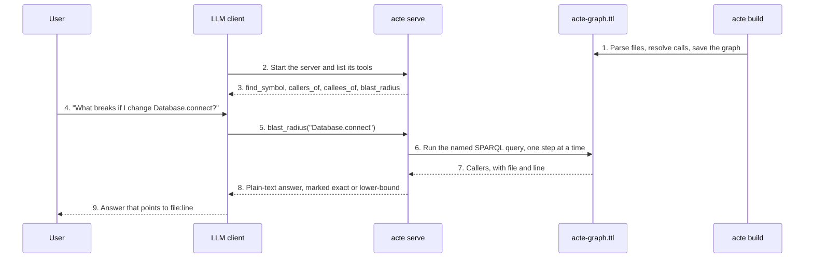

# ACTE: Autonomous Codebase Topography Engine

ACTE reads a project's source code and builds a graph of it: files, classes, functions, and
which function calls which. The graph is stored as RDF and queried with SPARQL. An LLM can
then ask questions like "who calls this function?" and get an answer from the graph, with
file and line for each result.



## How it works

| Layer | What it does |
|---|---|
| 1. Parse | tree-sitter reads each file and finds files, classes, functions and the links between them |
| 2. Build | the results are stored as RDF triples and can be saved as Turtle (`.ttl`) |
| 3. Query | a fixed set of SPARQL queries answers callers, callees, dependencies and dead code |
| 4. Serve | an MCP server lets an LLM run those queries as tools |

The LLM picks a query and gives it a name to look up. It does not write SPARQL itself.

## Status

You can build a map of a Python project and let an LLM client query it over MCP. The project
is still young.

| Part | State |
|---|---|
| Parsing | Python. Java, JavaScript, TypeScript, TSX and Go give structure only |
| RDF graph and Turtle output | Working |
| Call resolution | Python only (see Limitations) |
| Command line (`acte build`, `acte stats`, `acte serve`, `acte analyze`) | Working |
| Checks on real projects | Working (rich, httpx, click, flask) |
| MCP server | Working, tested with opencode and Claude Code |

## Quickstart

```bash
pip install "acte[jedi] @ git+https://github.com/dhruv970331/Autonomous-Codebase-Topography-Engine.git"
cd your-project
acte build .            # writes acte-graph.ttl
```

To connect a client, copy [`examples/opencode.json`](examples/opencode.json) or
[`examples/mcp.json`](examples/mcp.json) (renamed to `.mcp.json` for Claude Code) into the
project folder. More in [`examples/README.md`](examples/README.md).

## Requirements

Python 3.11 or newer, and [Poetry](https://python-poetry.org/).

```bash
poetry install
poetry run pytest -q
```

To also test against pinned releases of rich, httpx, click and flask, run
`ACTE_REAL_REPOS=1 poetry run pytest tests/test_real_repos.py -s`. This is off by default.
It needs git and network access the first time, and takes a few minutes.

## Usage

### Command line

```bash
poetry run acte build src -o graph.ttl   # build one graph for a project folder
poetry run acte stats graph.ttl          # show what a saved graph contains and if it is healthy
```

`acte build PATH` reads every source file under `PATH`. In a git repository it uses the files
git tracks, so anything in `.gitignore` is left out. Outside git it skips folders like
`.venv`, `node_modules` and hidden folders. Names in the graph are relative to `PATH`, for
example `shop/db.py::Database.connect`, so moving the project does not change the graph.
Use `--no-jedi` to skip the jedi step. When it finishes, it prints the number of files,
functions, classes and calls, how many calls it resolved, and the health check results.
Calls in languages without call resolution, such as Go, are counted on a line of their
own and left out of the coverage.

`acte stats GRAPH` prints the same summary for a saved graph. It also shows how the graph was
built (folder name, git commit, versions), and the first problem rows for any failed health
check. With `--format json` it prints the same data as one JSON object, with all problem rows.

Both commands exit with code 1 if a health check fails.

### What does my change break?

```bash
poetry run acte impact src                  # your uncommitted changes
poetry run acte impact src --base main      # everything since main
```

`acte impact PATH` reads `git diff` in `PATH` and builds a fresh graph of the work tree.
Each changed line belongs to the innermost function or class around it. A definition's
decorators count as part of it. Blank lines and lines with only a comment are ignored, so
commenting out a line counts as removing it. Removed code counts for the definition it was
removed from. If a whole method was removed, its class counts as changed. For
each changed definition it lists everything that calls it, grouped by distance (2 steps by
default, set with `--depth`). A changed line outside any definition counts as a change to the
whole file, and the command lists the project files that import it. New files that git does
not track yet count as fully added. `--no-jedi` skips the jedi step, which makes the build
faster in CI.

The first line sums it up: how many definitions changed, how many others are affected, and
whether that count is `exact` or a `lower-bound`. `--limit` caps each list (default 50) and
says how many were left out. `--format json` prints the same data as one JSON object, for
scripts and CI. `--graph FILE` uses a saved graph instead of building one, and warns if it
was built at another commit. The exit code is 2 when `PATH` is not in a git repository or
git fails.

It cannot see definitions that the change deleted, because they are not in the new graph.
Deleting a whole top-level function shows up only as a change to its file. Check its old callers with
`callers_of` on a graph built before the change.

### Graph analysis

```bash
poetry run acte analyze graph.ttl [--top N] [--format text|json]
```

`acte analyze GRAPH` helps you find your way around a project you do not know yet. It reads
a saved graph and prints three things.

First, the functions and classes that the most code depends on. They are ranked with
PageRank over the resolved calls. Each one comes with `file:line`, its score, and how many
places call it directly. `--top` sets how many are shown (default 10).

Second, import cycles: groups of files that import each other in a loop, largest first.
Imports inside `if TYPE_CHECKING:` and inside functions count too, so a cycle may never
happen when the code runs.

Third, subsystems: groups of files that call and import each other a lot, found with the
Louvain method. Each group is named after its hub, the file with the most links inside the
group. Files with no links to other files are only counted.

`--format json` prints the same results as one JSON object, for scripts. There the files
with no links are listed as groups of one file. With the same installed versions, the
output is the same on every run. Only resolved calls are used, so a function that is
mostly reached through unresolved calls ranks lower than it should.

### MCP server

```bash
acte serve acte-graph.ttl [--project PATH] [--profile small|full]
```

The server talks MCP over stdio. Each answer is plain text. It starts with a one-line
summary, gives `file:line` for each result, and stays under about 4,000 characters. If it
has to cut the list short, it says so. If a name is not found, it suggests close matches. If
a name has more than one definition, it lists them all and lets the caller choose. With
`--project`, it warns when the project's current git commit differs from the one the graph
was built from.

| Tool | Profile | What it answers |
|---|---|---|
| `find_symbol` | small | functions and classes matching a name, allowing for case and typos |
| `callers_of` | small | who calls a function or creates a class, and whether the list is complete |
| `callees_of` | small | what a function calls, plus how many calls go outside the project or are unresolved |
| `blast_radius` | small | everything a change could affect, grouped by distance (1 to 3 steps) |
| `functions_in_file` | full | what one file defines |
| `dependencies_of` | full | what one file imports |
| `orphan_functions` | full | functions that no resolved call reaches (possible dead code) |
| `graph_info` | full | how the graph was built, how much is resolved, and health check results |

`small` is the default and offers the first four tools. `full` offers all eight.

### Python

The same steps from Python:

```python
from pathlib import Path
from acte.rdf_builder import build_graph
from acte.sparql_engine import SPARQLEngine

root  = Path("src")
graph = build_graph(sorted(root.rglob("*.py")), root)   # parse, resolve calls, build
graph.serialize("graph.ttl", format="turtle")

engine = SPARQLEngine(graph=graph)
engine.callers_of("db_connect")
engine.blast_radius("db_connect", depth=3)
engine.functions_in_file("src/app.py")
engine.dependencies_of("src/app.py")
engine.orphan_functions()
```

## Results

PyCG call-graph benchmark (`tests/test_pycg.py`): precision 1.00 and recall 0.50, meaning
117 of the 233 expected links are found and none of the links found are wrong. One case is
left out of the precision count, and the test explains why.

Real projects (`tests/test_real_repos.py`, pinned releases):

| Project | Files | Coverage | Link precision | Link recall |
|---|---|---|---|---|
| rich 13.9.4 | 190 | 88.9% | 0.98 | 0.94 |
| httpx 0.28.1 | 60 | 87.4% | 0.99 | 0.96 |
| click 8.1.8 | 16 | 84.2% | 0.98 | 0.76 |
| flask 3.1.0 | 24 | 58.5% | 1.00 | 0.86 |

Coverage is the share of calls into the project's own code that were resolved, with jedi
on. Precision and recall compare a build without jedi to jedi's own references, over 40
sampled functions. Jedi misses some references too, so a precision below 1.00 does not
always mean a wrong link.

Small model test (`eval/`): Qwen 3.6 35B-A3B answered 41 of 41 questions correctly using the
MCP tools, at temperature 0. The questions are about ACTE's own code and there are only 41,
so this is a quick sanity check and too small to count as a benchmark.

## Limitations

- Call resolution only works for Python. Java, JavaScript, TypeScript, TSX and Go files get
  their structure but no call links. Their imports are read but not yet kept in the graph.
  In JavaScript, TypeScript and TSX, a function stored in a variable (`const f = () => ...`)
  is read as a function named `f`. Other function values, such as callbacks, are not
  functions of their own: their calls count for the function around them. The same goes
  for functions defined inside them, so two such functions with the same name in one file
  can share an id.
- Some calls stay unresolved. ACTE only links a call when it is sure of the target. If a
  call could go to more than one place, it is stored as ambiguous. `callers_of` and
  `blast_radius` then mark their answer as `lower-bound`, meaning there may be more callers.
- Values passed around are not tracked. A method call on a variable is resolved only if the
  variable's type is known, from a type hint or an assignment like `db = Database()`.
  Functions used as callbacks, stored in dicts or wrapped in decorators are not followed.
- Inheritance uses the class written in the code, not the class of the object at run time.
  Methods are looked up through that class's MRO. A call to a base-class method (through
  `self`, `cls`, a variable typed as the base class, or found by jedi) is listed as a
  possible caller of every override in the project, and the answer is marked `lower-bound`.
  Calls through `super()` are not listed for overrides. If the lookup reaches a base class
  from outside the project, such as `dict` or a library class, it stops there. A method it
  has not found by then stays unresolved, and answers it might affect are marked
  `lower-bound`.
- The dead-code list shows too much. Entry points, `__init__` methods, properties, functions
  passed as values, and functions reached only through unresolved calls all appear in
  `orphan_functions`.
- rdflib keeps the whole graph in memory. That limits ACTE to roughly 5,000 files. The
  largest project tested so far is rich: 190 files, built in about 24 seconds.

## Design notes

[`docs/architecture.md`](docs/architecture.md) explains the graph format and the main design
choices. [`docs/roadmap.md`](docs/roadmap.md) lists planned work.

## Licence

Not chosen yet.
