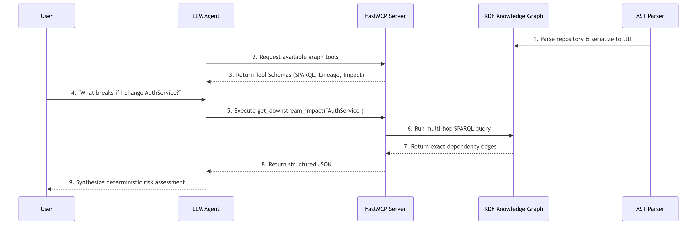

# ACTE: Autonomous Codebase Topography Engine

ACTE parses source code into an RDF knowledge graph and answers structural questions about
it with SPARQL. The goal is that a language model reasoning about a codebase queries proven
relationships instead of inferring them from retrieved text.

Vector search over code returns passages that *look* relevant. A graph query returns the
functions that actually call the one you changed. ACTE is built on the second.



## How it works

| Layer | Does |
|---|---|
| **1. Parse** | tree-sitter walks the AST and extracts files, classes, functions, and the edges between them |
| **2. Build** | those become RDF triples in a `code:` namespace, serialisable to Turtle (`.ttl`) |
| **3. Query** | a fixed set of named SPARQL queries answers callers, callees, dependencies, and dead code |
| **4. Serve** | an MCP server exposing those queries as LLM tools (*not yet implemented*) |

Queries are hardcoded by design. The model chooses which named query to run and supplies
arguments; it never writes SPARQL.

## Status

Early. Layers 1 to 3 exist and are tested; layer 4 has not been started.

| | State |
|---|---|
| AST extraction | Working for Python; Java, JavaScript and TypeScript extract structure only |
| RDF graph + Turtle output | Working |
| Named SPARQL queries | 8 implemented |
| Cross-file call resolution | Working for Python, see Limitations |
| Command line (`acte build`, `acte stats`) | Working |
| MCP server | Not implemented |

## Requirements

Python 3.11+ and [Poetry](https://python-poetry.org/).

```bash
poetry install
poetry run pytest -q
```

## Usage

### Command line

```bash
poetry run acte build src -o graph.ttl   # parse a project folder into one Turtle graph
poetry run acte stats graph.ttl          # what a saved graph holds, and whether it is healthy
```

`acte build PATH` parses every source file under `PATH`. In a git repository it takes the
files git knows about, so everything in `.gitignore` is left out; elsewhere it skips folders
such as `.venv`, `node_modules` and hidden ones. Ids are relative to `PATH`
(`shop/db.py::Database.connect`), so the graph does not depend on where the project sits.
`--no-jedi` skips the jedi step. It prints how many files, functions, classes and calls it
found, the share of calls resolved, and the result of the health checks.

`acte stats GRAPH` prints the same summary for a saved graph, plus how it was built (folder
name, git commit, versions) and, for any failing health check, the first rows that break it.

Both commands exit with 1 when a health check fails.

### Python

The same pipeline from Python:

```python
from pathlib import Path
from acte.rdf_builder import build_graph
from acte.sparql_engine import SPARQLEngine

root  = Path("src")
graph = build_graph(sorted(root.rglob("*.py")), root)   # parse, resolve calls, build
graph.serialize("graph.ttl", format="turtle")

engine = SPARQLEngine(graph=graph)
engine.callers_of("db_connect")
engine.blast_radius("db_connect", depth=3)
engine.functions_in_file("src/app.py")
engine.dependencies_of("src/app.py")
engine.orphan_functions()
```

## Limitations

Stated plainly, because they affect what the results mean.

- **Not every call is resolved.** A call is linked only when its target is certain. Calls
  that could go to several places are recorded as ambiguous, and `callers_of()` and
  `blast_radius()` label their answers `lower-bound` when such calls might reach the target.
- **Method calls on variables resolve only when the variable's type is known**, from an
  annotation or an assignment like `db = Database()`. Values passed around (callbacks,
  dicts, decorators) are not followed.
- **Dead-code detection over-reports.** Entry points, `__init__` methods, properties and
  functions passed as values or reached only through unresolved calls show up in
  `orphan_functions()`.
- **Go and TSX are mapped to file extensions but have no grammar rules**, so those files
  produce a file node and nothing else.
- **Class inheritance is not extracted.** The `code:inherits` predicate exists but nothing
  emits it.
- **The graph is held in memory.** Practical ceiling is in the low thousands of files. The
  Turtle output loads into an external triplestore if more is needed.

## Design notes

See [`docs/architecture.md`](docs/architecture.md) for the ontology and the reasoning behind
the main design choices, and [`docs/roadmap.md`](docs/roadmap.md) for planned work.

## Licence

Not yet chosen.
